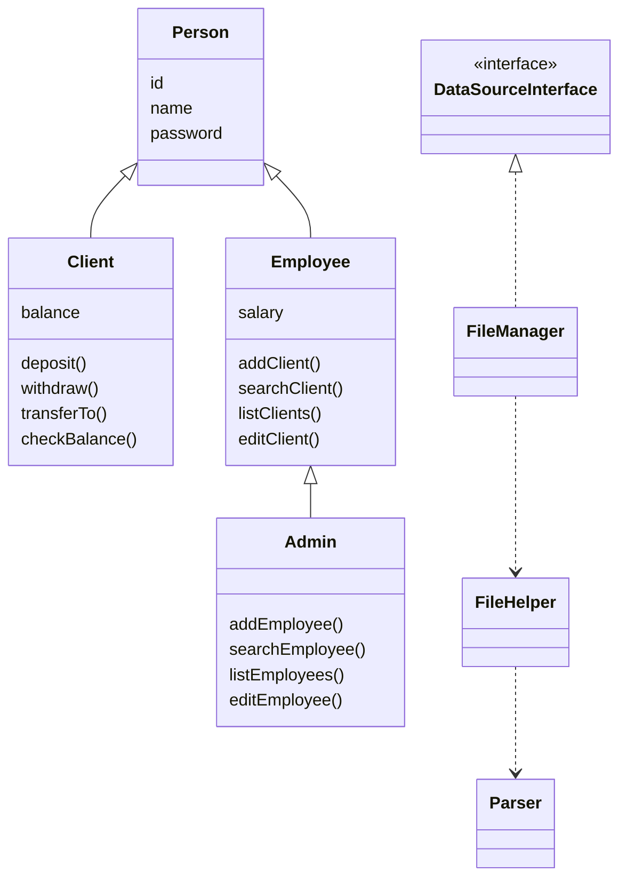

<div align="center">

# 🏦 Bank System

**A console banking application in C++ with three roles (Client, Employee and Admin), built with OOP and file-based storage.**


</div>

---

## 📑 Table of Contents

- [Overview](#-overview)
- [Features](#-features)
- [Architecture](#-architecture)
- [Project Structure](#-project-structure)
- [Getting Started](#-getting-started)
- [Class Reference](#-class-reference)
- [Author](#-author)

---

## 🌟 Overview

**Bank System** is a menu-driven console application that simulates a small bank. Each user logs in with an ID and password and gets a menu that matches their role:

| Role | Can do |
|---|---|
| 👤 **Client** | Deposit, withdraw, transfer to another client, check balance, update password |
| 🧑‍💼 **Employee** | Everything a client can see, plus add, search, list and edit **clients** |
| 🛡️ **Admin** | Everything an employee can do, plus add, search, list and edit **employees** |

All data is saved in plain text files, so it survives between runs.

It was built as a **Programming 2** project to practice object-oriented programming, file handling and clean separation of responsibilities in C++.

---

## ✨ Features

- 🔐 **Role-based login** for clients, employees and admins
- 💰 **Account operations**: deposit, withdraw, transfer, balance check (with insufficient-funds checks)
- 🗂️ **Client and employee management**: add, search by ID, list all, edit
- 💾 **Persistent storage** in `Clients.txt`, `Employees.txt` and `Admins.txt`
- ✅ **Input validation**:
  - Names: letters only, 5–20 characters
  - Passwords: 8–20 characters
  - Client opening balance: at least **1500**
  - Employee salary: at least **5000**
- 🧭 **Menu-driven interface** with clear screens for each role

---

## 🏛 Architecture



| Layer | Classes | Responsibility |
|---|---|---|
| **Models** | `Person`, `Client`, `Employee`, `Admin` | Data and business rules |
| **Validation** | `Validation` | Static checks for names, passwords, balance and salary |
| **Data** | `DataSourceInterface`, `FileManager`, `FileHelper`, `Parser` | Reading and writing the text files |
| **UI** | `Screens`, `ClientManager`, `EmployeeManager`, `AdminManager` | Menus and application flow |

---

## 📂 Project Structure

```
Bank/
├── Programming2_Project.cpp      # main() → Screens::runApp()
├── Programming2_Project.vcxproj  # Visual Studio project
│
├── Person.h / .cpp               # Base class
├── Client.h / .cpp
├── Employee.h / .cpp
├── Admin.h / .cpp
├── Validation.h / .cpp
│
├── DataSourceInterface.h / .cpp  # Storage contract
├── FileManager.h / .cpp          # Implements DataSourceInterface
├── FileHelper.h / .cpp           # File read/write helpers
├── Parser.h / .cpp               # Text line → object
│
├── Screens.h / .cpp              # Welcome + login screens
├── ClientManager.h / .cpp        # Client menu
├── EmployeeManager.h / .cpp      # Employee menu
├── AdminManager.h / .cpp         # Admin menu
│
├── Clients.txt                   # Sample data
├── Employees.txt
└── Admins.txt
```

---

## 🚀 Getting Started

### Prerequisites

- Windows
- [Visual Studio 2022](https://visualstudio.microsoft.com/) with the **Desktop development with C++** workload

### Run

1. Clone the repository
   ```bash
   git clone https://github.com/ahmedramzyelsheikh/Bank.git
   ```
2. Open `Programming2_Project.vcxproj` in Visual Studio.
3. Press **F5** to build and run.

Sample accounts for each role are in `Clients.txt`, `Employees.txt` and `Admins.txt`. Each line holds `id name password balance/salary`.

> ℹ️ The app uses `system("cls")` to clear the screen, so it is meant for the Windows console.

---

## 📘 Class Reference

<details>
<summary><b>Models</b></summary>

**Client**: `id`, `name`, `password`, `balance`
- `deposit(amount)`, `withdraw(amount)`, `transferTo(amount, recipient)` (all check for sufficient funds)
- `checkBalance()`, `display()`

**Employee**: `id`, `name`, `password`, `salary`
- `addClient(client)`, `searchClient(id)`, `listClients()`, `editClient(id, name, password, balance)`

**Admin** (inherits `Employee`)
- `addEmployee(employee)`, `searchEmployee(id)`, `listEmployees()`, `editEmployee(id, name, password, salary)`

</details>

<details>
<summary><b>Validation</b></summary>

Static methods: `isValidName(name)`, `isValidPassword(password)`, `isValidBalance(balance)`, `isValidSalary(salary)`.

</details>

<details>
<summary><b>Data layer</b></summary>

**DataSourceInterface** (abstract): `addClient`, `addEmployee`, `addAdmin`, `getAllClients`, `getAllEmployees`, `getAllAdmins`, `removeAllClients`, `removeAllEmployees`, `removeAllAdmins`.

**FileManager**: implements `DataSourceInterface` on top of the text files.

**FileHelper**: `saveLast`, `getLast` (last used ID), `saveClient`, `saveEmployee`, `getClients`, `getEmployees`, `getAdmins`, `clearFile`.

**Parser**: `split(line)`, `parseToClient(line)`, `parseToEmployee(line)`, `parseToAdmin(line)`.

</details>

<details>
<summary><b>User interface</b></summary>

**Screens**: `bankName()`, `welcome()`, `loginOptions()`, `loginAs()`, `invalid(choice)`, `runApp()`.

**ClientManager**: `printClientMenu()`, `updatePassword(person)`, `login(id, password)`, `clientOptions(client)`.

**EmployeeManager**: `printEmployeeMenu()`, `newClient()`, `listAllClients()`, `searchForClient()`, `editClientInfo()`, `login()`, `employeeOptions()`.

**AdminManager**: `printAdminMenu()`, `login()`, `adminOptions()`.

</details>

---

## 👨‍💻 Author

<div align="center">

**Ahmed Ramzy**

[](https://github.com/ahmedramzyelsheikh)

⭐ If you like this project, give it a star!

</div>
